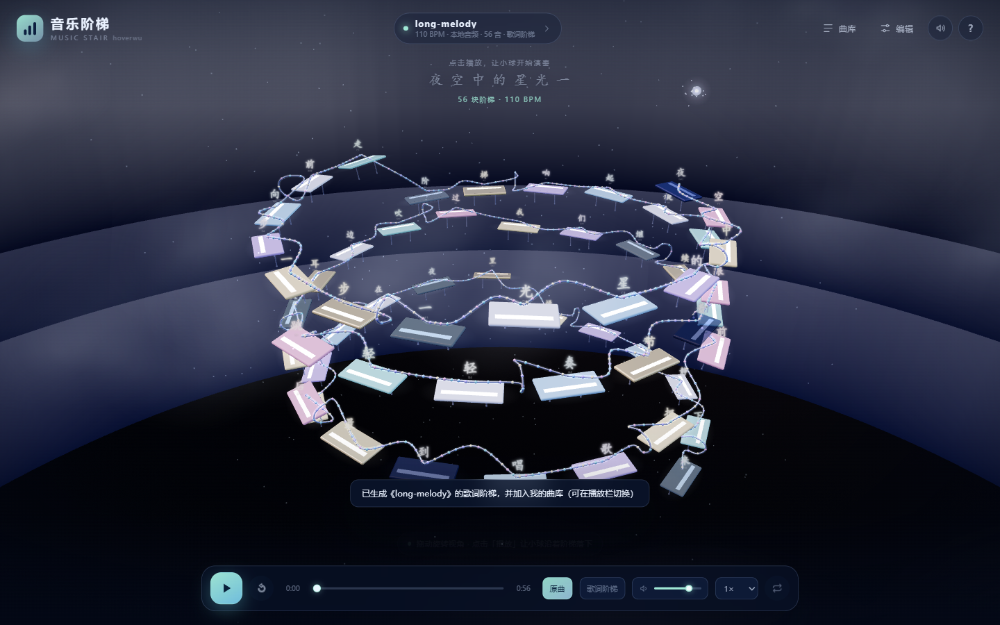

# Music Stair Builder

把一段音乐变成可以走、可以弹的三维阶梯。这个仓库是一个 **Qoder Skill**：它把「音乐阶梯」H5 的架构、时间轴、音频分析、LRC 歌词、编辑器、长曲性能与验收方法，整理成 Agent 可以直接执行的工程手册。

作者 hoverwu · 版本 0.1.0 · MIT License



> 小球沿着阶梯与导轨下落，每碰到一块就发出一个音；支持原曲伴奏、LRC 逐字、双变体布局、可视化编辑与本地曲库。
>
> 截图来自提炼本 Skill 的原始项目 MusicStair v0.4.0。原工程体积较大，这里只开源可复用的 Skill，不包含完整工程与运行时素材。

## 这个 Skill 解决什么问题

从零做一个 Three.js + WebAudio 的音乐可视化，最容易在四个地方翻车：

1. **音画不同步**：用 rAF 累加时间、把 beat 整拍量化、音频曲目多叠了一段前奏。
2. **导入只播十几秒**：只解码/分析了片段，没有按整曲时长渲染。
3. **长曲卡死**：320 块阶梯每块一个 Mesh、每段两根 Tube，draw call 上千。
4. **切到阶梯音没声音**：暂停时 `AudioContext.suspend()` 与恢复播放竞态。

这份 Skill 给出已经实测跑通的公式、数据契约、构建顺序、六个坑和一套可执行的验收矩阵，而不是只讲概念。

## 内容

```text
music-stair-builder/
  SKILL.md                          Agent 主入口：决策、数据契约、构建顺序、坑
  references/
    architecture.md                 模块、状态、存储、变体、时钟、数据流
    audio-and-lyrics.md             解码、起音、基频、BPM、伴奏、LRC
    timeline-and-editor.md          时间轴公式、飞行/导轨、编辑事务、增删/另存
    rendering-and-performance.md    场景、实例化、合并导轨、相机、移动端
    testing-and-acceptance.md       测试矩阵、CDP + Playwright、FPS 探针
  snippets/
    layout-generator.js             notes -> pads/segments
    timeline-sample.js              t -> 小球位置，含飞行时间
    lyrics.js                       LRC 解析、逐字阶梯、歌词套用
    audio-analysis.js               整曲解码、起音、基频、BPM
    synth-engine.js                 多分音音色、混响、预调度
    storage.js                      localStorage 布局 + IndexedDB 媒体库
  assets/                           验收截图
```

代码片段是 MIT，可以直接复制；文档里的数值（0.12 秒最小起音间隔、320 块上限、120 块实例化阈值、1.8 DPR 上限）都来自实测，不是拍脑袋。

## 安装

Qoder 的用户级 Skill 目录：

```text
Windows: C:\Users\<你的用户名>\.qoder-cn\skills\
macOS/Linux: ~/.qoder-cn/skills/
```

把 `music-stair-builder` 整个文件夹放进去：

```bash
git clone <this-repo> music-stair-builder
# 然后把整个文件夹移动到 ~/.qoder-cn/skills/ 下
```

也可以只在某个项目里使用：把文件夹放到项目根的 `.qoder/skills/`（取决于你的 Qoder 版本支持的本地 Skill 路径），或直接把 `SKILL.md` 作为工程约束交给 Agent。

安装后在支持 Skill 的 Qoder 里选择 `music-stair-builder`，或用自然语言描述任务，例如：

```text
用 music-stair-builder，从零做一个音乐阶梯 H5：
Three.js 台阶 + WebAudio 音色，支持导入 MP3 和 LRC，
能按歌曲节奏或歌词逐字生成阶梯，手机 390px 可用。
```

```text
用 music-stair-builder 检查这个项目：导入的音频只播十几秒，
阶梯和原曲也对不上，先定位原因再改。
```

```text
用 music-stair-builder 给现有阶梯加“插入/删除/飞行时间/另存”，
保持 segments = pads - 1，并补一套 Playwright 验收。
```

## 适用与不适用

适合：

- 从零复刻“小球弹板奏乐”的 3D 网页玩具。
- 给已有 Three.js 项目加音频分析、LRC、编辑器、曲库。
- 排查音画不同步、只播片段、长曲卡顿、切换音源静音。

不适合：

- 需要服务端转码、版权曲库、多人房间的项目。
- 需要专业级转谱/和弦识别的项目。这里的基频是单声部估计，必须提供人工编辑兜底。
- 纯 2D 音乐游戏判定或纯音频处理库。

## 四个默认决策

| 决策 | 默认 | 原因 |
| --- | --- | --- |
| 曲子来源 | 内置数据 + 本地导入 | 在线曲库有跨域与版权问题 |
| 音高 | 起音 + 自相关基频 | 轻量、可离线；不准时靠编辑器修 |
| 规模 | 普通 <120 块，长曲 ≤320 块 | 超过阈值切实例化与合并导轨 |
| 存储 | 元数据 localStorage，音频 Blob IndexedDB | 避免 base64 撑爆 5MB 配额 |


## 已验证的数据

- 320 块长曲，Intel UHD Graphics 630，1440×900：预热后 26.8 / 23.9 / 26.8 FPS。
- 纯 LRC 可在没有音频时直接转换为逐字阶梯；导入同名音频后合并为同一张卡片，并可切换歌曲/歌词两套布局。
- 插入、删除首/中/尾、撤销/重做、另存后 `pads.length - 1 === segments.length`。
- 原曲播放中切阶梯音，振荡器计数从 0 增长到数百，不再静音。
- 390×844 手机视口无横向溢出，编辑器底部可滚动。


## 设计原则

1. **时间轴是纯函数**。位置只由 `t` 与 `beat` 决定；拖块改变视觉，不改变命中时刻。
2. **数据先于界面**。先固定 `note/pad/segment/layout/song`，再写 DOM。
3. **编辑是小事务**。草稿 + 确定/取消 + 完整快照撤销，不做“改一下写一下”。
4. **测量先于优化**。先看 draw call 和材质数量，再谈降采样。
5. **失败要可解释**。解码失败、配额不足、歌词无时间行，都要给具体原因与下一步。

## 版本

- 0.1.0（2026-10-26）：首个公开版本。提炼自 MusicStair v0.4.0 的验收实现。

## License

MIT。见 [LICENSE](LICENSE)。

---

## English summary

A Qoder Skill for building a 3D "music stair" web toy with Three.js and WebAudio: audio onset/pitch analysis, LRC-to-per-character stairs, song/lyric layout variants, a visual editor with insert/delete/flight-time/save-as, local media storage, and a tested performance/acceptance playbook. The full demo project is not included; this repository contains the reusable skill, references, and MIT-licensed code snippets. Author: hoverwu. Version 0.1.0.
